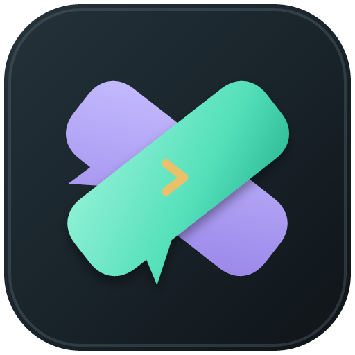
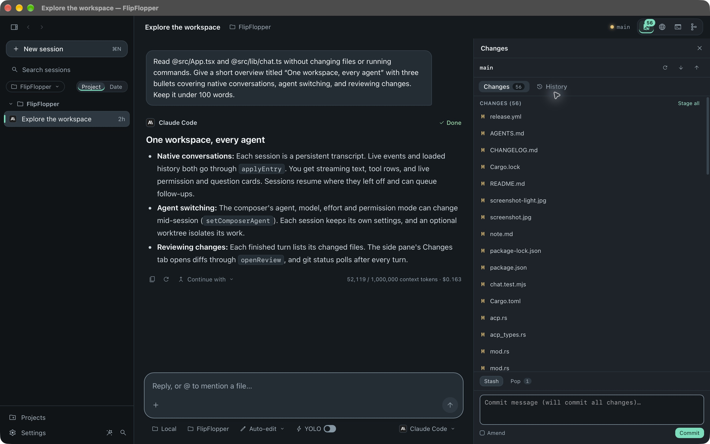

<div align="center">



# FlipFlopper

**One conversation. Every CLI coding agent. Flip any time.**

FlipFlopper is a cross-platform desktop app with a conversation-first
interface for every CLI coding agent. Sessions, transcripts with tool calls
and inline diffs, a changes pane, a live preview and a terminal all live in one
window, and you can switch the agent behind a conversation mid-stream without
losing context.

[](https://github.com/AraujoJordan/FlipFlopper/actions/workflows/build.yml)
[](https://github.com/AraujoJordan/FlipFlopper/releases)
[](LICENSE)
[](https://tauri.app)
[](https://solidjs.com)
[](https://www.rust-lang.org)
[](#getting-started)

</div>

---

<div align="center">
  
</div>

## 🤔 But why??

Because the whole agentic-coding industry is running on VC cash and government
subsidy money right now, well below what the underlying tokens actually cost,
specially on subscription models. They're all hoping to lock you in on their cli to increase costs later.

FlipFlopper treats CLI agents as swappable engines instead of a home you move into:
same terminals, same git history, same project context, whichever agent is behind 
the wheel. When one vendor tightens the screws, you flip to another instead of 
flopping around rewriting your whole setup. No agent loyalty here, we're
serial monogamists at best.

## ✨ Features

- **Sessions sidebar** - every conversation, grouped by project, with live status (running, finished, failed) and a worktree badge. Rename, archive, delete, search.
- **Native Claude and Cursor integration** - persistent ACP connections with live permission, question and plan cards, using the agent's CLI login and configuration. Model/effort pickers follow the agent's catalog; native commands use `/agent:<command>`. See the Cursor authentication limitation below.
- **Structured chat for every agent** - native ACP or headless JSON streams give you streamed markdown, collapsible tool calls (read / edit / run / search / web), inline diffs for edits, and a "Changed N files - Review" footer per turn.
- **Flip agents mid-conversation** - pick another agent (and model / effort) in the composer. FlipFlopper owns the transcript: agents that can resume their own session do, and the others get a digest of the conversation so far.
- **Composer** - `@` file mentions, `/` commands and skills, queued follow-ups while a turn runs, stop button, and a Plan / Auto-edit / Full access permission picker. A one-click **YOLO** switch enables Full access for any chat agent; switch it off to restore your previous permission mode. Enabling YOLO converts the current session. Claude/Cursor apply the change live, including pending tool approvals; headless CLIs keep their current launch policy until the next turn, marked in the composer.
- **Changes pane** - working-tree changes, stage / unstage / discard, stash, commit, push / pull, squash-and-push with an AI-generated message, history, and native diffs.
- **Preview and terminal panes** - start the project's dev server and see it in a live frame; run validation and tests; shell terminals; or resume a session in the agent's own terminal UI.
- **Isolated git worktrees** - run a session in its own `flipflopper/wt-*` branch so edits never touch your branch until you merge back from the Changes pane.
- **Multi-agent flow canvas** - chain sessions into a pipeline: queue downstream prompts off any session, hold a step behind a review gate, carry the upstream conversation forward, and pin per-step model / effort. Step status comes straight from each session's turns.
- **Import your CLI history** - bring existing Claude Code and Codex terminal sessions into the sidebar; continuing one resumes the original CLI session, and you can flip it to another agent.
- **Command palette (⌘K)** - search session titles and the text of every conversation, jump to projects, run actions.
- **Attachments** - drag files onto the window, pick them, or paste screenshots; native agents receive supported images directly; files remain available by their paths.
- **Agent registry** - detects installed CLI agents, their PATH and versions.
- **New Project wizard** - walks you through category, stack, details, name, and folder, then seeds the composer with a structured brief.
- **Optional local project setup** - opening an existing folder adds no agent files and does not initialize Git. Settings → General → Set up locally creates missing agent defaults in a Git project and excludes only those new files through Git's local `info/exclude`; team files and the shared `.gitignore` stay unchanged. Existing files, including files generated by older versions, are left alone; tracked files remain tracked.
- **Circuit appearance and motion** - graphite and jade in dark mode, porcelain and deep jade in light mode, with iris agent handoffs. Responsive pane transitions, live message/tool feedback, Flow movement and retained dialog exits. Settings → Appearance offers System, Reduced and Off motion; system reduced-motion preferences are respected.
- **Keyboard shortcuts** (`?` for the reference), and an in-app updater on Windows / Linux.
- **Native window controls** - the operating system handles close, minimize, maximize, fullscreen, resizing and title-bar behavior on macOS, Windows and Linux.

## 🕹️ Supported agents

| Integration | Agents | Status |
|---|---|---|
| Native ACP sessions | Claude Code | Real prompt, resume, questions and terminal handoff checked locally |
| Native ACP sessions | Cursor CLI (`cursor-agent acp`) | Protocol initialization checked; authenticated sessions currently blocked by the CLI's authentication response |
| Headless chat | Codex, agy, Qwen Code, Kimi Code | Exercised against real CLI output |
| Headless chat | OpenCode, Droid, Grok, Aider, Goose | Adapters based on documented output formats |
| Detection and terminal | Plandex, Cline | Chat support pending |

**Cursor authentication:** the tested CLI build (`2026.07.01-41b2de7`) still
returns “Authentication required” from ACP after `cursor-agent login` succeeds.
An authenticated Cursor prompt/resume smoke test has not passed yet. The app
surfaces that error and offers CLI sign-in/update actions.

Claude and Cursor reuse their CLI authentication. Settings → Agents provides
CLI sign-in, update and readiness actions; FlipFlopper does not collect API keys
or passwords. If a saved native session is missing or belongs to another checkout,
the app offers to continue in a new session using transcript context. Stop closes
pending requests, and opening the agent's terminal UI detaches the idle native
connection first. Extract portable archives in full, including the Node sidecar
and `agent-runtime` directory.

## 🧱 Stack

- **Backend:** Rust + Tauri 2 (`src-tauri/`)
- **Frontend:** SolidJS + Vite + TypeScript (`src/`)
- **Native agent runtime:** ACP v1 Rust SDK; pinned Claude ACP helper 0.94.0 and checksummed Node 24.22.1 bundled with every installer/portable archive. No system Node needed for the installed app; native Claude requires macOS 13.5+.
- **Key crates:** `agent-client-protocol`, `async-process`, `futures`, `portable-pty` (shell terminals), `which`, `ignore`, `dirs`, `tokio`, `base64`
- **Key npm bits:** `@xterm/xterm`, `@xterm/addon-fit`, `highlight.js`, `@material-symbols/svg-400` (Google Material Symbols, bundled offline)

For the full file-by-file source map, see the "Source Map" section in
[AGENTS.md](AGENTS.md), the canonical, agent-facing architecture doc that
this README stays in sync with.

## 📦 Download

**macOS via Homebrew:**

```sh
brew tap AraujoJordan/tap
brew install --cask flipflopper
```

**Everyone else:** pre-built binaries are attached to each
[GitHub Release](https://github.com/AraujoJordan/FlipFlopper/releases):

| Platform | Installer |
|---|---|
| macOS (Apple Silicon) | `.dmg` (arm64) or `brew install --cask flipflopper` |
| macOS (Intel) | `.dmg` (x64) or `brew install --cask flipflopper` |
| Windows | `.msi` or NSIS `.exe` |
| Linux | `.AppImage` or `.deb` |

Portable binary archives are also available. Extract the entire archive: the
app needs its bundled `flipflopper-node` sidecar and `agent-runtime` resources.

### Keeping FlipFlopper up to date

- **macOS** — update via Homebrew: `brew upgrade --cask flipflopper`.
- **Windows & Linux** — the app checks for new versions automatically on launch. When an update is available, an indicator appears in the title bar and a **Check for Updates…** entry lives in the Help menu.

---

## 🚀 Getting started

To build from source, you'll need [Node.js](https://nodejs.org) 22+ (24 recommended), [Rust](https://rustup.rs), and the
[Tauri prerequisites](https://tauri.app/start/prerequisites/) for your OS.

```sh
npm install            # grab the frontend deps
npm run tauri dev      # compile Rust, hot-reload frontend, open the app
npm run tauri build    # production build when you're ready to ship
```

Desktop dev/build commands prepare the pinned agent helper and verify the Node
sidecar's download checksum. Installed apps do not need system Node. Install
and sign in to the CLI agents you want to use; native Claude requires macOS
13.5 or newer on a Mac. `npm run dev` starts the web frontend only.

Choose a project, start a session and send a task. Use the composer to change
agent, model, permissions or worktree mode. Review edits in **Changes**, start
a dev server in **Preview**, open a shell in **Terminal**, or chain sessions in
**Flow**. `⌘/Ctrl+K` opens search and `⌘/Ctrl+L` focuses the composer.

Run checks from the repository root:

```sh
npx tsc --noEmit
npm run test:chat
npm run prepare:agents
cargo check
cargo test --lib
npm run build
```

## 🤝 Contributing

PRs and issues welcome. See [CONTRIBUTING.md](CONTRIBUTING.md) for dev setup,
sanity checks, and commit conventions, and the
[Contributor Covenant](CODE_OF_CONDUCT.md) for community expectations. Found
a security issue? See [SECURITY.md](SECURITY.md) instead of filing a public
issue (we promise not to make you fill out a CVE form in crayon).

## ™️ Trademarks and notices

FlipFlopper itself is MIT licensed (see below). The agent logos bundled in
[`public/agents/`](public/agents/) are trademarks of their respective owners
(Anthropic, OpenAI, Google, and the rest), used here purely to identify each
tool so you know which button does what. FlipFlopper is an independent project
and is not affiliated with, sponsored by, or endorsed by any of them.

## 📜 License

[MIT](LICENSE) (c) 2026 Jordan L. Araujo Jr. Go build something. Flip
responsibly.

---

<div align="center">

[](https://star-history.com/#AraujoJordan/FlipFlopper&Date)

</div>
